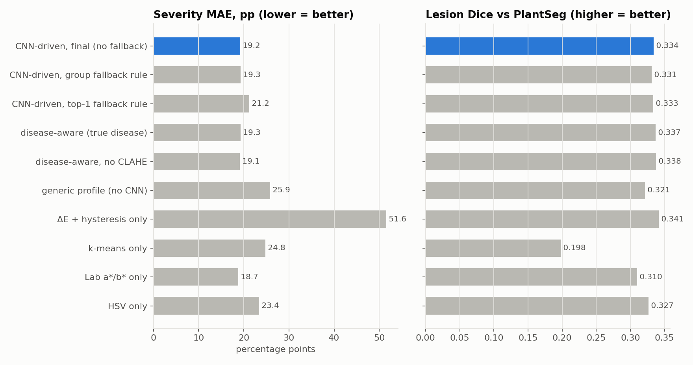
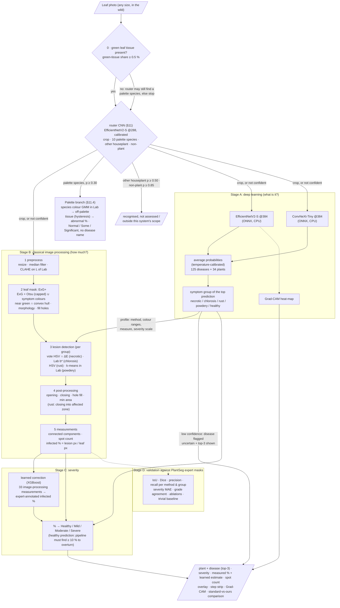
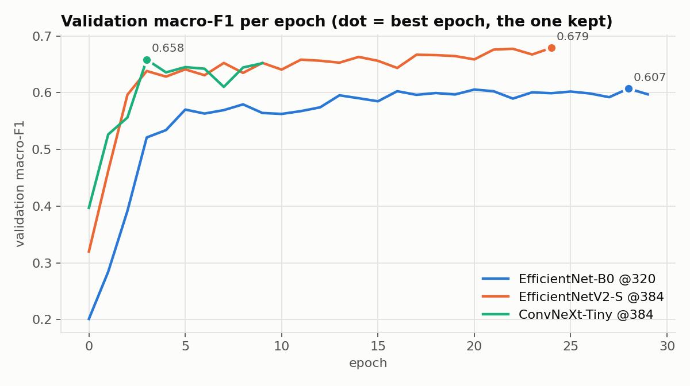
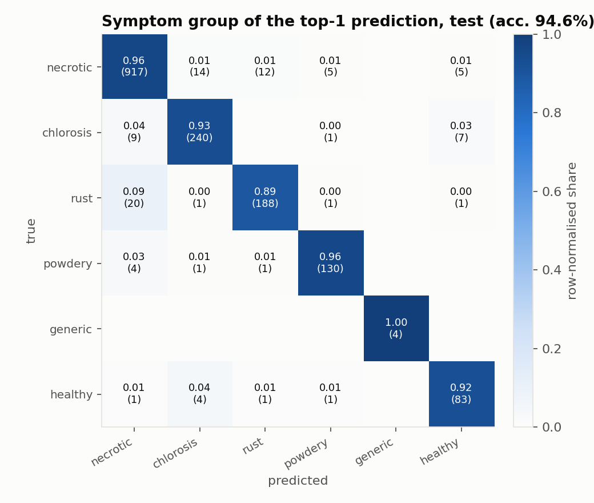
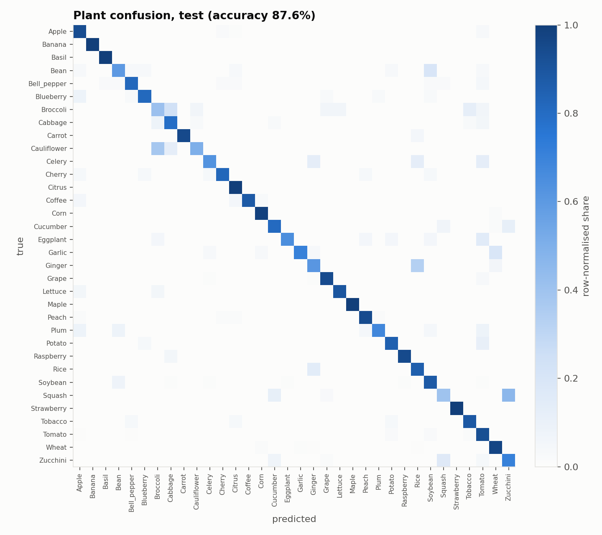
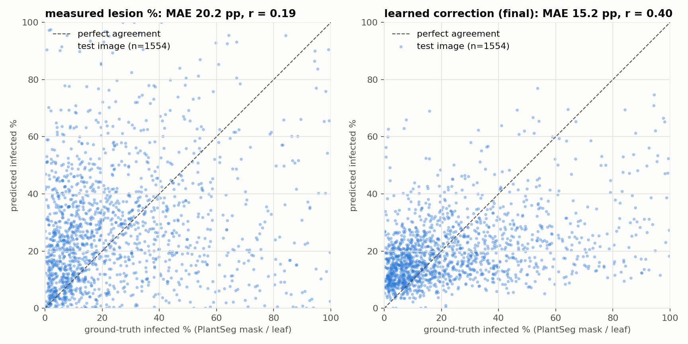

# Leaf Disease Spot Detection & Severity Estimation

A hybrid **deep learning + classical image processing** system that, from a single in-the-wild leaf
photo, tells you **which plant and disease** it is and **how severe** the infection is, together with
the step-by-step image-processing evidence behind that number.

- **Stage A (deep learning, "what is it?"):** an ensemble of EfficientNetV2-S and ConvNeXt-Tiny,
  trained on cloud NVIDIA T4 GPUs, classifies 125 plant-disease classes across 34 host plants.
- **Stage B (classical image processing, "how bad is it?"):** an OpenCV / NumPy / scikit-image
  pipeline segments the leaf, detects lesions, cleans them with morphology and measures the
  infected % of leaf area, using **disease-specific methods and parameters chosen by Stage A**.
- **Stage C (severity):** infected % → Healthy / Mild / Moderate / Severe, plus a small learned
  correction (XGBoost on image-processing measurements) that maps our measurement to the experts'
  annotation convention.
- **Stage D (validation):** the classical pipeline is measured pixel-by-pixel against the
  **expert lesion masks of PlantSeg**, something most leaf-disease projects cannot do.

> **Scope.** The disease pipeline is built for **green crop leaves**: it measures disease as "not healthy
> green" tissue, and its classifier knows 125 crop classes. A **router** CNN in front of it (§11) sends
> everything else elsewhere: ornamental plants with coloured or variegated leaves (croton, coleus, purple
> heart, pothos …) go to a **palette branch** that compares the leaf with that species' learned normal
> colours and never names a disease; other houseplants and non-plant photos, including green objects, are
> recognised and stopped. Crop photos stay in the unchanged crop pipeline (0.85 % of crop test photos are
> routed away). Details: §7 (green-tissue gate), §11 (router and palette branch) and §15.

**Quick start (macOS, Linux or Windows):** `git clone`, install the Python requirements, run the demo:
everything needed (trained weights, calibrated ensemble, learned severity model, router, species palettes,
example images) is in this repository. See [§17](#17-run-it-yourself).

---

## Contents

1. [Executive summary](#1-executive-summary)
2. [Results at a glance](#2-results-at-a-glance)
3. [Progression: how we got here](#3-progression-how-we-got-here)
4. [Architecture](#4-architecture)
5. [Dataset and data engineering](#5-dataset-and-data-engineering)
6. [Stage A: plant + disease classifier](#6-stage-a-plant--disease-classifier)
7. [Stage B: classical image-processing pipeline](#7-stage-b-classical-image-processing-pipeline)
8. [Stage C: severity grading](#8-stage-c-severity-grading)
9. [Stage D: evaluation methodology](#9-stage-d-evaluation-methodology)
10. [Detailed results](#10-detailed-results)
11. [Router and palette branch](#11-router-and-palette-branch-ornamentals-non-green-leaves-non-plants)
12. [What makes this approach different](#12-what-makes-this-approach-different)
13. [Trade-offs](#13-trade-offs)
14. [Error analysis](#14-error-analysis)
15. [Limitations and future work](#15-limitations-and-future-work)
16. [Repository structure](#16-repository-structure)
17. [Run it yourself](#17-run-it-yourself)
18. [Data licence and attribution](#18-data-licence-and-attribution)

---

## 1. Executive summary

**In one line:** deep learning identifies the disease; classical image processing finds and measures the
lesions; a small classical-ML model calibrates the severity number. **The segmentation itself uses no
learning at all**, which is why it is explainable step by step and costs ~0.1 s per image on a laptop CPU.

On **1,644 held-out in-the-wild test images** (PlantSeg test split + PlantDoc healthy leaves):

- **Classifier:** the ensemble names the exact plant + disease (125 classes) **78.7 %** of the time
  (top-5 **96.4 %**, macro-F1 **0.728**) and the **symptom group 94.6 %** of the time; its confidence is
  calibrated (expected calibration error 0.156 → 0.031).
- **Lesion segmentation (classical, no training on masks):** Dice **0.356** / IoU **0.247** against the
  expert masks, between DeepLabv3 and DeepLabv3+ trained on the same data (§10.8).
- **Severity:** the final estimate is off by **15.2 percentage points** on average (median 10.6), grades
  severity **within one class for 93.4 %** of diseased leaves and keeps healthy leaves at **4.0 %**
  false-positive area. It is the only variant that beats the trivial "always predict 16 %" baseline
  (16.9 pp); the raw colour measurement alone (20.2 pp) does not, which we report openly (§10.6).
- **The CNN measurably improves the image processing:** steering the pipeline with the predicted symptom
  group cuts the measured severity error from **25.9 → 20.2 pp** and healthy-leaf false positives from
  **20.8 % → 4.3 %**; with the real classifier it matches the result obtained with the *true* disease
  (20.1 pp).
- **Method:** everything was chosen on the validation split; the test split was evaluated in two
  clearly labelled rounds (round 1, then round 2 with detector voting + the learned correction). Data
  leakage (339 duplicate photos) was removed, and the dataset's own problems (label noise, broken masks,
  region- vs spot-level annotation) are measured and documented.
- **Cost:** the classical pipeline takes ~0.1 s per image on a laptop CPU; the whole demo (two CNNs,
  Grad-CAM, the standard-pipeline comparison, the learned estimate) takes ~1–3 s and ~1.2 GB RAM.
- **Beyond crop leaves (§11):** a calibrated **router** CNN in front of the pipeline sends ornamentals,
  other houseplants and non-plant photos elsewhere while keeping **99.15 %** of crop test photos in the
  unchanged crop pipeline; it stops **90 %** of green non-plant test objects (the green-tissue gate alone stopped 1 of 41). For 10
  coloured or variegated ornamentals, a **palette branch** (per-species colour model + classical
  segmentation) no longer calls healthy plants diseased: **11.5 %** of healthy ornamental test photos
  flagged, vs **80 %** "diseased" from the crop pipeline. Detecting *small* damage on whole-plant web photos
  is still weak (synthetic-damage AUC ≈ 0.55), which we report as a limitation.

---

## 2. Results at a glance

All numbers are on the **held-out test split** (official PlantSeg test split + PlantDoc healthy test
images). Every choice was made on the validation split. The test split was evaluated in **two rounds**:
round 1 (the first complete system) and round 2 (detector voting + learned severity correction, §10.6);
both are shown so nothing is hidden.

| Component | Metric | Round 1 | **Final (round 2)** |
|---|---|---|---|
| **Classifier** (ensemble, 125 classes) | top-1 / top-5 accuracy | 78.7 % / 96.4 % | **78.7 % / 96.4 %** |
| | macro-F1 | 0.728 | **0.728** |
| | plant accuracy (34) / symptom-group accuracy (6) | 88.5 % / 94.6 % | **88.5 % / 94.6 %** |
| | calibration error (ECE, lower = better) | 0.156 | **0.031** (temperature scaling) |
| **Lesion segmentation** (1,554 diseased images) | Dice / IoU (higher = better) | 0.334 / 0.234 | **0.356 / 0.247** |
| | pixel precision / recall | 0.413 / 0.429 | 0.391 / **0.505** |
| **Severity** (infected % of leaf) | mean / median absolute error (lower = better) | 19.2 / 12.9 pp (measured) | **15.2 / 10.6 pp** (learned estimate) |
| | grade exactly right / within one grade | 41.9 % / 82.6 % | **42.3 % / 93.4 %** |
| | rank correlation with the experts (Spearman) | 0.26 | **0.40** |
| **Healthy leaves** (90 images) | mean false-positive area / graded *Healthy* | 4.3 % / 87.8 % | 4.0 % / 84.4 % |
| **Trivial baseline** | always predict 16 % (validation median) | 16.9 pp, grade 29.3 % | 16.9 pp, grade 29.3 % |
| **Effect of the CNN** | measured severity MAE, generic profile → CNN-driven | 25.9 → 19.2 pp | 25.9 → 20.2 pp |
| | healthy false positives, generic → CNN-driven | 20.8 % → 4.3 % | 20.8 % → 4.3 % |

**Router and palette branch** (§11, added later; test = routing-only third use of the crop test split, first use
of the ornamental / houseplant / non-plant photos):

| Component | Metric | Test |
|---|---|---|
| **Router** (13 classes, EfficientNetV2-S) | crop photos moved out of the crop pipeline | **0.85 %** (14 / 1,649) |
| | ornamentals → right palette / houseplants recognised / non-plants stopped | 91.4 % / 96.9 % / 94.6 % |
| | green non-plant objects stopped (green-tissue gate alone: 1 / 41) | **90.2 %** (37 / 41) |
| **Palette branch** (442 healthy ornamental photos) | flagged as not "Normal" (crop pipeline: graded diseased) | **11.5 %** (80.3 %) |
| | synthetic damage, image ROC-AUC (5 / 10 / 20 % of the plant) | 0.53 / 0.55 / 0.57 (weak, §11.5) |



*Test split, round 2 (1,554 diseased images). Left: severity error, lowest first; the final system
(CNN-driven pipeline + learned correction) is the only one below the trivial constant baseline. Right:
lesion-mask overlap with the expert annotation (the learned correction and the constant output a
percentage, not a mask, so they have no Dice).*

---

## 3. Progression: how we got here

Every change was kept only if it improved the **validation** metrics. Classical-pipeline rows are
the disease-aware pipeline on the validation split (843 diseased + 114 healthy images) unless noted.

| # | Change | Severity MAE (pp) ↓ | Label agreement ↑ | Lesion Dice ↑ | Healthy-leaf FP % ↓ |
|---|---|---|---|---|---|
| v1 | ExG + Otsu leaf mask, hand-picked lesion methods (30-image sample) | 44.0 | 4 % | 0.06 | 0.0 |
| v2 | **ExG+** leaf mask: green cap + symptom expansion (sample) | 17.8 | 50 % | 0.22 | 18.6 |
| v3 | + convex-hull constraint on symptom expansion (full val) | 19.2 | 35 % | 0.26 | 10.9 |
| v4 | + per-group method/parameter **grid search on val**, rust "affected zone", healthy verification (full val) | **17.4** | **45 %** | **0.34** | **6.1** |
| v5 | + CNN-driven profile from the **real classifier**, uncertainty rule chosen on val | **17.2** | **44.7 %** | 0.33 | 7.3 |
| **test (round 1)** | **first evaluation of the test split** | **19.2** | **41.9 %** | **0.33** | **4.3** |
| v6 | + necrotic **detector voting** (HSV ∩ ΔE, chosen on full val); temperature scaling | 17.1 (necrotic) | – | 0.326 (necrotic) | – |
| v7 | + **learned severity correction** (XGBoost, 33 image-processing features, 5-fold CV on val) | 12.8 (CV) | – | – | – |
| **test (round 2)** | **second use of the test split**: measured lesions / learned estimate | 20.2 / **15.2** | 39.6 % / **42.3 %** | **0.356** | 4.3 / 4.0 |

| # | Classifier | Test top-1 | Test top-5 | Test macro-F1 | Plant acc. |
|---|---|---|---|---|---|
| C1 | EfficientNet-B0 @320 px | 72.1 % | 92.5 % | 0.642 | 82.2 % |
| C2 | EfficientNetV2-S (IN-21k) @384 px | 76.7 % | 93.7 % | 0.705 | 87.0 % |
| C3 | ConvNeXt-Tiny (IN-22k) @384 px | 73.8 % | 95.6 % | 0.680 | 83.5 % |
| **C4** | **Ensemble C2 + C3 (chosen on val)** | **78.7 %** | **96.4 %** | **0.728** | **88.5 %** |

| # | Router / palette branch (§11), **validation** | Crop moved out ↓ | Ornamentals routed ↑ | Green objects stopped ↑ | Healthy ornamentals: median abnormal % ↓ | Synthetic damage AUC ↑ |
|---|---|---|---|---|---|---|
| R1 | Router EfficientNet-B0 @224, temperature + thresholds on val | 0.97 % | 83.2 % | 90.9 % | – | – |
| **R2** | **Router EfficientNetV2-S @288 (chosen)** | **0.76 %** | **95.7 %** | **100 %** | – | – |
| P1 | Palette GMM on GrabCut pixels (no CLAHE: halo fix), optional dull/brown filter, thresholds from all fit pixels | – | – | – | ≤ 0.9 | not measured (Dice 0.07–0.44 on an earlier, easier synthetic set) |
| P2 | + trimming 10 / 30 %, core-or-all thresholds, a more sensitive grid; synthetic lesions no longer silently missing | – | – | – | ≤ 1.9 | 0.49–0.64 |
| P3 | + optional "brown is always abnormal" seeds (never chosen), "Normal" cut-off from healthy photos | – | – | – | ≤ 1.9 | 0.51–0.64 (final) |

Things we tried that did **not** help, and kept out: test-time flip augmentation, plant-head
re-weighting of disease scores (both neutral-to-negative on validation), the ΔE+hysteresis lesion
detector on its own (highest recall, 0.83, but heavy over-detection; it is useful only inside a vote),
a strict "green border ratio" filter on the leaf mask (small false-positive gain at a recall cost),
**vein suppression** with a Sato ridge filter and **glare masking** (≤ 0.5 pp gain, offset by lower Dice),
a **density-adaptive affected zone** for all groups (helps rust only), and an XGBoost **spot-vs-zone
switch** (−0.1 pp).

---

## 4. Architecture



---

## 5. Dataset and data engineering

**Primary:** [PlantSeg](https://github.com/tqwei05/PlantSeg), Zenodo **v7** (Nov 2025, `plantseg.zip`,
1.1 GB, MD5 verified). We verified the format by inspecting the files rather than assuming it:

| Fact (verified) | Value |
|---|---|
| Images | **7,774** (the 2024 preprint reports 11,458; the released v7 has 7,774) |
| Classes | 115 diseases on 34 host plants |
| Official split | train 5,367 / val 846 / test 1,561 (`Metadata.csv`) |
| Mask encoding | grayscale PNG, 0 = background, lesion pixels = `Index + 1` (one disease per image) |
| Healthy images | **none** in v7 |

**Healthy leaves:** the 10 PlantDoc "healthy" classes whose plants also occur in PlantSeg
(apple, bell pepper, blueberry, cherry, grape, peach, raspberry, soybean, strawberry, tomato):
646 train / 114 val / 90 test. Final label space: **125 classes** (115 diseases + 10 healthy), 34 plants.

**Data problems we found and fixed** (processed on a cloud machine; the full dataset never touched the laptop):

| Problem | Evidence | Fix |
|---|---|---|
| Duplicate photos across splits (leakage) | 368 cross-split pairs by perceptual hash (dHash, Hamming ≤ 4); 8/8 inspected pairs were true copies | 339 train/val copies removed; official test split untouched |
| **Same photo under two different diseases** | e.g. identical image as *cauliflower alternaria* and *cabbage alternaria*, *soybean* vs *tobacco frog-eye* | documented as label noise (irreducible classifier error) |
| 12 masks with a neighbouring class value | broccoli masks carry 25 instead of 24, etc. → empty after exact matching | binarise with "any non-zero pixel" |
| 29 masks with a different size than their photo | likely EXIF rotation | excluded from mask evaluation (0.4 %) |
| Non-leaf disease classes | fruit rot, wheat heads, smut, cavity spot … | 18 labels tagged `non_leaf`, reported separately |

**Leaf area has no ground truth.** PlantSeg masks mark lesions, not leaves, so "% of leaf infected"
needs a leaf denominator. We use one **shared denominator** for prediction and ground truth (see §9),
and additionally report image-level ratios that do not depend on our leaf mask at all.

---

## 6. Stage A: plant + disease classifier

| Choice | Value | Why |
|---|---|---|
| Backbones | EfficientNetV2-S (ImageNet-21k) and ConvNeXt-Tiny (ImageNet-22k) @384 px | 21k/22k pre-training helps fine-grained classes; lesions are small, so more pixels help |
| Heads | 125-way disease head + 34-way plant head (auxiliary, weight 0.3) | plant head = easier extra signal and a plant prediction |
| Schedule | 2 epochs heads-only, then full fine-tuning; AdamW, warm-up + cosine; label smoothing 0.1 | standard transfer-learning recipe |
| Precision | AMP fp16 on CUDA only (T4); fp32 on MPS/CPU | device-agnostic code |
| Imbalance | `WeightedRandomSampler`, weight ∝ 1 / count^0.5 | full inverse frequency would repeat a 3-image class ~100× per epoch |
| Augmentation | random resized crop, flips, ±20° rotation, brightness/contrast/saturation jitter, **no hue jitter** | hue shifts would turn brown lesions green, i.e. change the label |
| Selection | early stopping on **validation macro-F1** | accuracy hides rare classes |
| Compute | cloud NVIDIA T4 (16 GB), ~35–75 s/epoch; a checkpoint every epoch so interrupted runs resume | |
| Calibration | temperature scaling fitted on validation (T = 0.70): ECE 0.156 → 0.031 | makes the "uncertain" flag trustworthy |
| Deployment | ONNX Runtime on CPU: ~0.6 s for both models on an Apple M1 | no GPU needed |

The final classifier (ensemble, chosen on validation) puts the **top-1 prediction in the right symptom
group for 94.6 % of test images** even though the exact disease is right for 78.7 %: most errors are the right disease on
the wrong plant (*bell-pepper frog-eye → soybean frog-eye*, *potato early blight → tomato early blight*),
which matters because the image pipeline only needs the group.




---

## 7. Stage B: classical image-processing pipeline

Only OpenCV, NumPy, scikit-image and scikit-learn (k-means). Every stage can save its intermediate
image (`run_pipeline(...)["steps"]`, the demo's step strip, `reports/figures/pipeline_strips.jpg`).

| Step | Technique | Why |
|---|---|---|
| 0. Scope gate | share of the image that is green plant tissue: ExG > 0.05 **and** HSV saturation ≥ 40; < 0.5 % → "outside this system's scope" (stop), < 3 % → warning | the CNN is closed-set (it names a plant disease for *any* image) and the ExG + Otsu leaf mask is relative, so a hand or a wall would otherwise be "analysed"; non-green leaves (red maple, purple cabbage) are also out of scope, since disease is measured as "not healthy green". On 464 real plant photos the share is ≥ 1 % (median 76 %); non-plant scenes give ~0 % |
| 1. Preprocess | resize (long side 768, `INTER_AREA`), median filter 5×5, **CLAHE on the L channel of Lab** | Lab separates lightness from colour, so contrast improves without shifting lesion hues |
| 2. Leaf mask | **ExG+** (ours): Excess Green `2g − r − b` on chromatic coordinates + Otsu, with a cap so clearly green pixels are always leaf; plus symptom-coloured pixels (yellow/brown/white/dark) that are near green tissue **and inside the convex hull** of a green region; closing, hole filling, keep largest components | plain ExG+Otsu splits full-frame leaves in two and cuts off diseased margins (kept only 23 % of true lesion pixels); ExG+ keeps 94 % |
| 3. Lesions (per symptom group) | necrotic: **vote** = HSV "not healthy green" ∩ ΔE-from-the-leaf's-own-healthy-colour (+ hysteresis); chlorosis: **Lab b\*** > max(Otsu, floor); powdery: **k-means (k=4) in Lab**, whitest clusters; rust: **HSV** orange band; generic: HSV "not healthy green" | each symptom has a different colour signature; the method per group was chosen on validation (grid search, then the full validation split) |
| 4. Post-process | opening 3×3, closing 5×5, hole filling (flood fill from the border), area filter, restrict to leaf; **rust: closing with a disk ∝ √(leaf area) into an "affected zone"** | removes speckle, merges fragments; rust pustules are rated (and annotated) as one infected area |
| 5. Measure | connected components (8-connectivity): spot count, spot areas; infected % = lesion px / leaf px | |

Also implemented and compared: HSV leaf thresholding, **GrabCut** seeded from the ExG mask, Lab a\*
thresholding, and the **ΔE + hysteresis** detector on its own (Canny-style strong/weak thresholds: very
high recall, too many false positives alone, useful inside a vote).

`python -m src.evaluation.figures` writes `reports/figures/pipeline_strips.jpg`: one **typical** image
per symptom group (the image whose Dice is closest to its group's median, not hand-picked) through every
step. It contains dataset photos, so it is generated locally and not committed.

---

## 8. Stage C: severity grading

Default scale (configurable, `configs/severity.yaml`): **< 1 % Healthy, 1–10 % Mild, 10–25 % Moderate,
> 25 % Severe**. These cut-offs are **our assumptions**, inspired by percentage-of-area rating scales such
as Horsfall–Barratt; they are not an agronomic standard.

- **Uncertainty:** if the top disease has p < 0.5 it is reported as *uncertain* with the top-3. Which
  lesion profile to use in that case was **decided on validation** among three rules: fall back to the
  generic profile when p(top-1 disease) < 0.5 (val MAE 19.8 pp), when p(symptom group) < 0.5 (17.3), or
  never fall back (17.2, and the fewest healthy false positives). We use the last: **even an uncertain but
  specific profile beats the generic one**, because most CNN errors stay within the right symptom group.
- **Healthy verification:** when the CNN says *healthy*, the pipeline must find ≥ 10 % infected area to
  overturn it (median false positive on healthy validation leaves is 0.7 %, so small detections are
  glare, veins or background).
- **Outside scope:** images with < 0.5 % green plant tissue are stopped before any analysis, with a message
  that this is either not a plant or a non-green leaf (e.g. red maple); 0.5–3 % gives a "results may be
  unreliable" warning (in our data that range only contains fruit / root photos).
- **Non-leaf diseases** (fruit/heads/stems) trigger a warning that leaf-area severity is approximate.
- **Learned estimate:** next to the measured %, the system reports a learned estimate of the
  expert-annotated affected area (§10.6); it is the more accurate severity number, while the measured %
  is the one you can trace to the step images.

---

## 9. Stage D: evaluation methodology

- **Pixel metrics** of our lesion mask P vs the PlantSeg mask G: IoU, Dice, precision, recall.
- **Severity with a shared denominator:** D = |L ∪ G| (our leaf mask plus any true lesion pixels it missed);
  predicted % = |P| / D, true % = |G| / D. Because both use the same denominator, the severity error comes
  only from lesion detection, not from leaf segmentation.
- **Image-level ratio** |P| / image vs |G| / image (independent of our leaf mask).
- **Protocol:** method selection, parameter search, detector voting, uncertainty rule, ensemble,
  calibration and the learned correction were all decided on the **validation** split (a 435-image dev
  subset for fast iteration, then all 957 validation images). The **test** split was evaluated in two
  labelled rounds (§10.6).
- **Ablations:** each lesion method alone (incl. votes), generic profile (no CNN), disease-aware with the
  true disease (upper bound), CNN-driven (top-1 / group / no fallback), with vs without CLAHE, and a
  trivial constant baseline.

---

## 10. Detailed results

### 10.1 Classifier (test, 1,651 images)

| Model | top-1 | top-5 | macro-F1 | plant acc. |
|---|---|---|---|---|
| EfficientNet-B0 @320 | 72.1 % | 92.5 % | 0.642 | 82.2 % |
| EfficientNetV2-S @384 | 76.7 % | 93.7 % | 0.705 | 87.0 % |
| ConvNeXt-Tiny @384 | 73.8 % | 95.6 % | 0.680 | 83.5 % |
| **Ensemble (V2-S + ConvNeXt)** | **78.7 %** | **96.4 %** | **0.728** | **88.5 %** |

Validation also tested flip test-time augmentation and plant-head re-weighting
(`score = p(disease) · p(plant)^α`); neither improved validation macro-F1, so neither is used.
Temperature scaling (fitted on validation) changes only the confidence values, not the predictions.



### 10.2 Lesion methods per symptom group (test, Dice, higher = better)

| Symptom group | images | HSV | Lab | k-means | ΔE + hysteresis | vote HSV ∩ ΔE | vote Lab ∩ ΔE | used (chosen on validation) |
|---|---|---|---|---|---|---|---|---|
| necrotic | 950 | **0.337** | 0.294 | 0.161 | 0.309 | 0.331 | 0.284 | vote HSV ∩ ΔE |
| chlorosis | 256 | 0.223 | **0.376** | 0.163 | 0.370 | 0.210 | 0.352 | Lab b\* |
| rust | 209 | **0.395** | 0.259 | 0.230 | 0.390 | 0.393 | 0.258 | HSV + affected zone |
| powdery | 135 | 0.353 | 0.381 | **0.480** | 0.455 | 0.348 | 0.376 | k-means (whitest cluster) |

Choices were made on validation with the objective *Dice − MAE/100* (1 pp of severity error costs as much
as 0.01 Dice). On test, plain HSV overlaps marginally better for necrotic lesions (0.337 vs 0.331); the
vote was preferred on validation because it also lowers severity error and false positives.

### 10.3 Severity by group and by true severity (test, final system)

MAE in percentage points (lower = better); "measured" is the classical lesion %, "learned" the final
estimate (§10.6).

| Group | n | measured MAE | learned MAE | Dice | | True infected % | n | measured MAE | learned MAE |
|---|---|---|---|---|---|---|---|---|---|
| necrotic | 950 | 18.2 | **14.0** | 0.33 | | 0–5 % | 262 | 18.9 | **12.1** |
| chlorosis | 256 | 20.6 | **15.0** | 0.36 | | 5–15 % | 464 | 16.2 | **8.0** |
| rust | 209 | 21.9 | **17.3** | 0.39 | | 15–30 % | 344 | 15.8 | **8.7** |
| powdery | 135 | 30.9 | **21.5** | **0.47** | | 30–50 % | 267 | **17.8** | 17.9 |
| | | | | | | > 50 % | 217 | **40.6** | 41.6 |

The learned correction halves the error for lightly and moderately infected leaves (≤ 30 %), where pure
measurement over-detects, but does not fix very heavy infections (> 50 %), where the annotations outline
whole regions. Leaf diseases: 20.3 → 15.7 pp (n = 1,307); non-leaf diseases (fruit/heads/stems):
20.1 → 12.7 pp (n = 247).

Severity grades of the final estimate (rows = expert grade, columns = predicted; test):

| expert \ predicted | Healthy | Mild | Moderate | Severe |
|---|---|---|---|---|
| Healthy (< 1 %) | 2 | 9 | 11 | 7 |
| Mild | 3 | **148** | 305 | 45 |
| Moderate | 5 | 65 | **278** | 107 |
| Severe | 1 | 33 | 306 | **229** |

Most disagreements are one grade apart (93.4 % within one grade); the estimate leans towards *Moderate*.



*Test split, round 2. Left: the measured lesion % alone correlates weakly with the expert annotation
(r = 0.19; round 1: 0.21): errors are small up to ~30 % infection and large above 50 %, where annotations
outline whole diseased regions (see §14). Right: the learned correction (§10.6) doubles the correlation
(r = 0.40) and cuts the error to 15.2 pp, but it still compresses very heavy infections towards the middle
(cases above ~60 % are under-predicted).*

### 10.4 Leaf segmentation (no leaf ground truth: share of true lesion pixels inside our leaf mask, test)

| Method | true lesion pixels inside leaf | leaf share of image |
|---|---|---|
| ExG + Otsu | 25.6 % | 27.9 % |
| GrabCut (ExG-seeded) | 33.5 % | 33.4 % |
| HSV threshold | 84.2 % | 77.0 % |
| **ExG+ (ours)** | **93.9 %** | 86.7 % |

### 10.5 Ablations (test, round 2)

| Variant | severity MAE (pp) ↓ | grade agreement ↑ | Dice ↑ | healthy false positives ↓ |
|---|---|---|---|---|
| **final: CNN-driven + learned correction** | **15.2** | **42.3 %** | – | 4.0 % |
| CNN-driven, measured lesions | 20.2 | 39.6 % | 0.356 | 4.3 % |
| disease-aware with the *true* disease (upper bound for the CNN) | 20.1 | 39.8 % | 0.359 | 1.6 % |
| generic profile (no CNN) | 25.9 | 37.3 % | 0.321 | 20.8 % |
| without CLAHE | 19.7 | 39.6 % | 0.359 | 1.6 % |
| Lab only (one method for every group) | 18.7 | 39.2 % | 0.310 | 1.6 % |
| constant 16 % (trivial baseline) | 16.9 | 29.3 % | – | – |
| CNN-driven, fallback to generic if p(top-1) < 0.5 | 21.8 | 39.3 % | 0.348 | 8.3 % |
| CNN-driven, fallback to generic if p(group) < 0.5 | 20.3 | 39.7 % | 0.354 | 3.7 % |

Honest notes: **CLAHE brings no measurable benefit**: removing it slightly lowered the error in round 2
on both validation (18.6 → 18.3 pp) and test (20.1 → 19.7 pp), within noise; we keep it because it makes
the step images easier to read, and report the effect. **A single Lab method has the lowest measured MAE**
(18.7) but also the lowest Dice and recall; the disease-aware pipeline wins on overlap and above all on
**healthy-leaf false positives** (generic 20.8 % vs 4.3 %), and the learned correction (15.2) supersedes
any measured MAE. The "true disease" rows show 1.6 % healthy false positives because a correctly known
*healthy* label always selects the strict healthy profile.

### 10.6 Round 2: detector voting, learned severity correction, calibration (test used a second time)

After round 1 we found that **a constant prediction (the median of the diseased validation images, 16 %)
has a lower test MAE (16.9 pp) than pure colour measurement (19.2 pp)**. The reason is the annotation convention (§14): many
masks outline whole diseased regions, so measurement under-estimates heavy and over-estimates light
infections, and a mid-range constant scores well on MAE while being unable to grade, rank or outline
anything. Round 2 addresses this; every choice was again made on validation, and the test split was
evaluated a second time, which we state explicitly.

**Detector voting (necrotic group).** A pixel is a lesion only if HSV and ΔE-from-the-leaf's-own-healthy-
colour agree. Chosen on all 957 validation images by the same objective (Dice − MAE/100):

| Test, final system | Round 1 | Round 2 |
|---|---|---|
| lesion Dice / IoU | 0.334 / 0.234 | **0.356 / 0.247** |
| precision / recall | 0.413 / 0.429 | 0.391 / **0.505** |
| necrotic Dice | 0.298 | **0.333** |
| severity MAE (measured lesions) | **19.2** | 20.2 |

**Learned severity correction.** An XGBoost regressor maps 33 classical features (infected % from every
detector, affected-zone % at three scales, spot count / density / largest spot, convex-hull spread of the
lesions, Lab statistics, GLCM texture, predicted symptom group) to the annotated infected %. It is trained
**only on validation** (hyper-parameters by 5-fold CV; CV MAE 12.8) and applied to test in round 2.
CNN confidences are excluded so the demo (calibrated probabilities) sees the same inputs as training.

| Test, diseased leaves (n = 1,554) | MAE | median AE | grade agreement | within one grade | Spearman |
|---|---|---|---|---|---|
| A. measured lesion % (no learning) | 19.9 | 15.1 | 41.2 % | 82.0 % | 0.27 |
| B. constant 16 % (trivial baseline) | 16.9 | 11.3 | 29.3 % | 98.1 %\* | – |
| **C. learned correction (XGBoost)** | **15.2** | 10.6 | **42.3 %** | **93.4 %** | **0.40** |
| D. learned spot-vs-zone switch | 19.8 | 15.0 | 41.1 % | 82.9 % | 0.27 |

\* A constant 16 % is always graded *Moderate*, which is within one grade of almost everything, so that
column flatters it. On healthy test leaves the correction keeps false positives at 4.0 % (84 % graded
*Healthy*). Its most important features are the predicted group, the measured lesion %, the convex-hull
spread of the lesions and the affected-zone %: it learns *how experts draw their masks* from our own
image-processing measurements. (Rows A–D use lesion px / leaf px; §10.3 uses the shared denominator
|L ∪ G|, hence 19.9 vs 20.2.) The demo shows both numbers: the **measured** lesion % (directly
traceable to the step images) and the **learned estimate** of expert-annotated affected area.

**Calibration.** The ensemble was under-confident (label smoothing + averaging). Temperature scaling
fitted on validation (T = 0.70) cuts the test expected calibration error from 0.156 to **0.031**; the
"uncertain" flag now fires on 11.9 % of test images instead of 30.7 %, and the classifier is right 84.8 %
of the time when confident vs 33.7 % when flagged uncertain.

---

### 10.7 Demo: standard pipeline vs ours vs expert (unseen test images)

The demo (`bash demo/run_demo.sh`, or `demo\run_demo.ps1` on Windows) runs every photo through **our system and the standard textbook pipeline**
side by side (ExG + Otsu leaf mask, one fixed HSV "not green" rule; same preprocessing and clean-up, so only
the methods differ), with a pixel-difference view. Its **example gallery** holds 29 official test-split
images (`python -m src.data.make_demo_examples`; never used for training, tuning or fitting the correction,
and checked against train/val for near-duplicates), so the examiner can compare both pipelines with the
**expert annotation**. Over the 25 diseased gallery images:

| | standard | ours |
|---|---|---|
| lesion Dice vs expert | 0.114 | **0.312** (better on 22 / 25) |
| infected-% error vs expert | 20.2 pp | **16.7 pp** measured · **10.7 pp** learned estimate |
| severity grade = expert | 40 % | **48 %** |

### 10.8 Where learning is (and is not) used, inference cost, and context

> **Deep learning identifies the disease; classical image processing finds and measures the lesions; a
> small classical-ML model calibrates the severity number. The segmentation itself uses no learning at all.**

**The lesion segmentation is classical image processing: it never learns from the expert masks.** PlantSeg's
masks are used only as the answer key (to measure Dice / severity error) and, on the validation split, to
choose between colour methods and their thresholds. The three parts of the system:

| Part | Type | Learns from | Role |
|---|---|---|---|
| Stage A: EfficientNetV2-S + ConvNeXt-Tiny ensemble | **deep learning** (CNNs) | image-level disease labels | names plant + disease; never draws lesions |
| Stage B: leaf + lesion segmentation, measurement | **classical image processing** | nothing (thresholds / methods chosen on validation) | colour spaces, Otsu, ExG, convex hull, k-means on each image's own pixels, morphology, connected components |
| Round-2 severity correction (XGBoost) | **classical machine learning** (gradient-boosted trees, not deep learning) | 33 numbers measured by Stage B, on validation | adjusts infected % to the experts' annotation convention |

**Inference cost** (Apple M1, 8 GB, CPU only, mean over 12 gallery images):

| Stage | Type | Time / image |
|---|---|---|
| preprocessing | image processing | 18 ms |
| leaf mask (ExG+) | image processing | 30 ms |
| lesion detection | image processing | 3 ms (Lab) – 97 ms (k-means) |
| **whole classical pipeline** | **image processing** | **≈ 50–150 ms** |
| standard textbook pipeline (for comparison) | image processing | 32 ms |
| CNN ensemble (2 ONNX models) | deep learning | 615 ms |
| Grad-CAM explanation | deep learning | 1,765 ms |

The severity measurement is the cheap part; almost all of the demo's ~3 s goes to the deep-learning parts
(naming the disease and explaining that decision).

**Context: deep segmentation networks on the same dataset.** The PlantSeg authors' benchmark (Table 3 of the
paper) trains segmentation networks on the masks with GPUs: DeepLabv3 (ResNet-50) 17.2 % mIoU, DeepLabv3+
(ResNet-101) 27.2 %, SAN (ViT-L) 36.9 %, **SegNeXt (MSCAN-L) 44.5 %** (the paper's text quotes 53.9 % for
SegNeXt, which does not match its table). Our classical pipeline reaches a mean per-image IoU of **24.7 %**
(Dice 0.356) with no training on any mask, on a laptop CPU. The numbers are not strictly comparable (they
label each pixel with one of 115 diseases and average per class over the dataset; we separate lesion from
non-lesion and average per image), so read them as a reference range: classical colour methods land near
DeepLabv3-class networks, below the best large trained networks, which learn the annotators' region-drawing
style (§14). Training such a network as an upper bound is future work (§15).

**Performance comparison: standard pipeline vs ours vs deep segmentation networks**

| | Standard colour thresholding | **Ours (classical, disease-aware)** | Deep segmentation networks (PlantSeg paper) |
|---|---|---|---|
| How lesions are found | ExG + Otsu leaf, one fixed HSV rule | ExG+ leaf, CNN-chosen colour detector, voting, morphology | network trained pixel-by-pixel on the masks |
| Learns from expert masks | no | **no** (masks only used to evaluate / choose methods on validation) | yes, thousands of masks |
| Training needed | none | none for segmentation (the CNN classifier is trained on image labels) | GPU training of a large network |
| Lesion overlap | Dice 0.114 (25 gallery images) | **Dice 0.356 / IoU 0.247** (1,554 test images); Dice 0.312 on the same 25 gallery images | mIoU 17.2 % (DeepLabv3-R50) … **44.5 % (SegNeXt-L)** |
| Lesion-mask compute per image | 32 ms, CPU | **≈ 50–150 ms, CPU** | needs a large network forward pass; GPU-oriented (the paper reports no CPU timings) |
| Explainability | every step visible | every step visible, plus Grad-CAM for the disease choice | black box (needs separate explanation methods) |
| What it can't do | cuts off diseased margins, one rule for all symptoms | can't learn region-style annotations (hence the learned severity correction) | can't explain its masks; needs GPU + training data |

The comparable rows: on the same 25 unseen gallery images, ours triples the standard pipeline's Dice
(0.312 vs 0.114, better on 22 / 25). Against trained deep networks, our IoU (24.7 %) sits between
DeepLabv3 (17.2 %) and DeepLabv3+ (27.2 %), without training on any mask and on a laptop CPU, while the
best large network (SegNeXt-L, 44.5 %) remains clearly ahead. (Metric definitions differ: see above.)

---

## 11. Router and palette branch (ornamentals, non-green leaves, non-plants)

> Added after the main system. The crop pipeline, its weights, `disease_profiles.yaml`, `severity.yaml`
> and every crop-pipeline number in this README are unchanged: the crop route runs exactly the code it ran before (a unit test
> checks its output byte for byte).

### 11.1 The problem

The crop system has two blind spots, both caused by its design assumptions:

1. **The CNN is closed-set.** It always answers with one of its 125 crop classes: for a croton, a pothos or a
   green T-shirt alike. The green-tissue gate (§7, step 0) only stops photos with no green at all.
2. **Stage B assumes healthy tissue is green.** On a red croton, a purple *Tradescantia* or a white-and-green
   pothos, normal red/purple/white tissue is "not healthy green", so a healthy plant is measured as diseased
   (§11.5: the crop system grades **80 %** of healthy ornamental test photos as diseased and **50 %** as *Severe*).

### 11.2 Routing

A small CNN, the **router**, runs first and decides which pipeline the photo goes to:

```
photo
 ├─ green-tissue share < 0.5 %   (gate unchanged: the crop CNN is never run on these)
 │     ├─ router: a palette species with p ≥ t_palette → palette branch
 │     └─ anything else → stop: "outside this system's scope"
 └─ green-tissue share ≥ 0.5 %   → router
       ├─ top-1 "crop" (any confidence)            → crop pipeline, unchanged (§6–§8)
       ├─ top-1 palette species, p ≥ t_palette     → palette branch (§11.4)
       ├─ top-1 "other houseplant", p ≥ t_house    → "ornamental houseplant, not assessed"
       ├─ top-1 "non-plant", p ≥ t_nonplant        → stop: "outside this system's scope"
       └─ not confident                             → crop pipeline + warning "the plant may be outside our classes"
```

**Design rule: crop photos must never be pushed out of the crop pipeline.** "Not confident" defaults to the
crop pipeline, and each non-crop route needs a calibrated probability above a threshold chosen on validation
so that **at most 1 % of the crop validation photos** leave the crop pipeline (primary constraint); within
that budget the thresholds maximise correct routing of the other classes (secondary).

### 11.3 Router: data and model

| Class | Source | Images (train / val / test) | Licence |
|---|---|---|---|
| `crop` | PlantSeg + PlantDoc-healthy: a stratified **train** sample (all 125 classes) + the full official val / test splits | 2,845 / 924 / 1,649 | CC BY-NC 4.0 / CC BY 4.0 |
| 10 palette species (§11.4) | iNaturalist observations with CC-licensed photos, first photo per observation, flowering/fruiting observations excluded | ~208 / 45 / 44 each | mostly CC BY-NC (per-photo licence and author in the manifest) |
| `other_houseplant` | Kaggle *House Plant Species* (47 classes, 50 per class), minus the 4 classes that are palette species | 1,487 / 318 / 318 | CC BY-NC-SA 4.0 |
| `non_plant` | COCO 2017 val photos with no plant/fruit objects and < 2 % green, **plus Wikimedia Commons "green objects"** (doors, shirts, bottles, chairs, buses …) | 519 / 111 / 111 | COCO / per-file Commons licences |

All images were downloaded and resized (long side 384 px) **on a cloud machine**, near-duplicates were removed
with the same perceptual hash as §5 (Hamming ≤ 4, within and across classes and against the crop photos),
non-crop classes were split 70/15/15, and contact sheets were generated for every class (a sample was checked
by eye; the sheets are rebuilt by the collection script for a full review). The images are
not committed; [`manifests/router_manifest.csv`](manifests/router_manifest.csv) lists every image with its
source URL, licence and author, and `src/router/collect_router_data.py` rebuilds the set.

**Model.** ImageNet-pretrained CNN, one epoch heads-only, then full fine-tuning (AdamW, warm-up + cosine,
label smoothing 0.1, class-balanced sampling 1/count^0.5), augmentation **without any hue or saturation
jitter** (colour is exactly what separates a red croton from a diseased crop leaf). Trained on one cloud T4
(~1 min/epoch), temperature-calibrated on validation, exported to ONNX (`models/router/`).

| Router (chosen on **validation**) | Input | Val macro-F1 | Crop photos moved out | Ornamentals routed correctly | Houseplants | Non-plants | Green non-plant objects stopped | Mac CPU |
|---|---|---|---|---|---|---|---|---|
| EfficientNet-B0 (ImageNet-1k) | 224 px | 0.910 | 0.97 % | 83.2 % | 90.3 % | 96.4 % | 90.9 % | – |
| **EfficientNetV2-S (ImageNet-21k)** | 288 px | **0.969** | **0.76 %** | **95.7 %** | **98.1 %** | **99.1 %** | **100 %** | ~95 ms |

Calibration: temperature T = 0.56 (ECE 0.120 → 0.005 on validation). Thresholds (validation):
t_palette = 0.30, t_house = 0.50, t_nonplant = 0.85.

### 11.4 Palette branch (classical image processing + a per-species colour model)

For 10 ornamental species, chosen to mix **non-green** (croton, coleus, caladium, purple heart, copperleaf,
polka dot plant, bloodleaf, red cordyline) and **variegated green** leaves (golden pothos, dieffenbachia),
the branch learns what colours are *normal* for that species and marks leaf tissue that does not fit.
It gives **no disease name**: on ornamentals, browning is as often sun scorch, over- or under-watering or
cold as a pathogen. Every step saves an image for the demo's step strip.

**Fitting (offline, train photos only).** Stage B preprocessing (resize, median filter; **no CLAHE**, see
below) → a rough plant region with GrabCut (centre rectangle) → pixels in CIE **Lab** with L\* down-weighted
(feature `[0.3·L*, a*, b*]`: a\* and b\* carry the pigment, L\* mostly the lighting) → a **Gaussian mixture
model** with 6 components, fitted robustly (fit, drop the 10 % or 30 % least likely pixels, refit, twice) so
a few damaged leaves or background pixels do not become "normal". The likelihood thresholds are quantiles of
the training pixels' log-likelihood. Saved as `models/palettes/<species>.json` (means, covariances,
weights, thresholds, cut-offs); inference is pure NumPy.

**Inference.**

| Step | Technique | Why |
|---|---|---|
| 1. Preprocess | Stage B step 1 without CLAHE | CLAHE re-maps L\* by neighbourhood: healthy tissue next to a dark spot became an off-palette halo on our synthetic test leaf (Dice 0.73 → 0.995 without it) |
| 2. Palette likelihood | log p(x) of every pixel under the species GMM | one number per pixel: "how normal is this colour for this species" |
| 3. Leaf mask ("ExG+ generalised") | normal tissue = log p ≥ t_weak; add off-palette pixels that are near normal tissue **and** inside its convex hull **and** mostly bordered by it (the ExG+ rules of §7 with "green" replaced by "normal for this species"); closing, small-hole filling, largest components; very dark pixels (L\* < 20) are shadow, not tissue | the same reasoning as ExG+: damaged tissue is off-palette, so it would otherwise be cut out of its own leaf |
| 4. Abnormal tissue | **hysteresis**: weak = log p < t_weak, strong = log p < t_strong; keep weak regions that contain a strong pixel; opening/closing, minimum area | faint off-palette noise alone is ignored; a real spot keeps its full extent |
| 5. Measure | abnormal % = abnormal px / leaf px; connected components = regions | |
| 6. Label | **Normal** < 10 % ≤ **Some abnormal tissue** < 30 % ≤ **Significant abnormal tissue** | configurable assumptions (§11.5) |

**TREx.** The plan suggested the *Two-fold Red Excess* index (Agarwal et al., *Plant Methods* 2025,
doi:10.1186/s13007-025-01339-y) for red leaves. We checked the paper: TREx = 2R − G − B on raw RGB, proposed to
**estimate chlorophyll** (SPAD) in green and anthocyanin-rich leaves photographed on a white board; it is not a
segmentation index, so it is not used here. A per-species colour model covers red, purple and white tissue
without a hand-made index.

**Choosing the palette parameters on validation.** Per species, a grid over the dull/brown filter for fitting
(soil, mulch, bark and dead tissue left out or not), trimming strength (10 / 30 %), threshold basis (all fit
pixels or only the trimmed core), 9 threshold pairs (q_strong, q_weak) and an optional "brown pixels are always
abnormal" seed rule. **Primary constraint: median abnormal area on healthy validation photos ≤ 2 %** (all 10
species meet it); objective: Dice + image-level AUC on synthetic damage (§11.5). Full table:
[`reports/palette_val.md`](reports/palette_val.md).

### 11.5 Results

**Router: routing (validation chooses, test reports).** Test is the PlantSeg/PlantDoc test split's
**third use, for routing only, nothing tuned on it**; the ornamental / houseplant / non-plant test photos are
used for the first time. Reports: [`reports/router_val.md`](reports/router_val.md),
[`reports/router_test_routing.md`](reports/router_test_routing.md).

| | Validation | **Test** |
|---|---|---|
| Crop photos moved out of the crop pipeline (primary constraint, target ≈ 0–1 %) | 0.76 % (7 / 924) | **0.85 % (14 / 1,649)** |
| Ornamentals (10 species) routed to the right palette | 95.7 % | **91.4 %** (98.2 % kept out of the crop pipeline) |
| Other houseplants recognised | 98.1 % | **96.9 %** |
| Non-plant photos stopped | 99.1 % | **94.6 %** |
| **Green non-plant objects stopped** (the gap the green-tissue gate left open: it stops 1 of the 41 test objects) | 100 % (33) | **90.2 % (41)** |
| Router macro-F1 / expected calibration error | 0.969 / 0.005 | 0.935 / 0.007 |

**The published crop numbers stay valid.** The crop pipeline is unchanged, so every crop photo the router keeps
gets byte-identical results. The 14 moved test photos are diseased PlantSeg images (9 sent to "houseplant", 4 of
them bananas, which are also grown as houseplants; 4 sent to a palette species; 1 carrot photo to "not a plant"); dropping them from the round-1 test results changes every metric by at most **0.0012 Dice and
0.09 pp MAE** (table in `reports/router_test_routing.md`).

**Palette branch vs the crop pipeline on healthy ornamental test photos** (442 photos, 10 species, as labelled on
iNaturalist): the crop system calls most of them diseased, the palette branch does not.

| Healthy test photos | n | Crop pipeline: mean "infected" % | Crop pipeline: graded diseased | Crop pipeline: graded *Severe* | **Palette: mean abnormal %** | **Palette: not "Normal"** |
|---|---|---|---|---|---|---|
| variegated green (pothos, dieffenbachia) | 89 | 23.5 | 75.3 % | 48.3 % | **2.5** | **10.1 %** |
| non-green (8 species) | 353 | 29.3 | 81.6 % | 50.1 % | **3.4** | **11.9 %** |
| all 10 species | 442 | 28.1 | 80.3 % | 49.8 % | **3.2** (median 0.7) | **11.5 %** |

**Damage detection is the weak part (stated openly).** Licence-clean photos of *damaged* ornamental leaves
are rare (a Wikimedia title search found ~2 for our species), so damage was simulated: real PlantSeg
**validation** lesions pasted onto the healthy test photos' normal tissue until they cover 5 / 10 / 20 % of
the plant region.

| Synthetic damage (test) | True damaged % of our leaf mask (median) | Predicted abnormal % (median) | Image ROC-AUC vs healthy | Pixel Dice |
|---|---|---|---|---|
| 5 % of the plant | 1.8 | 0.9 | 0.53 | 0.18 |
| 10 % of the plant | 3.1 | 1.2 | 0.55 | 0.19 |
| 20 % of the plant | 5.7 | 1.5 | 0.57 | 0.19 |

The branch **does not reliably detect small damage on whole-plant web photos** (validation showed the same,
AUC 0.56–0.61). The cause is the training data, not the idea: the palettes are fitted on unsegmented scene
photos (whole plants in gardens, pothos climbing tree bark), so they absorb soil, bark and mulch colours, and
brown lesions then look "normal". Removing brown from the palettes, or treating brown as always abnormal, made
the bark and soil between leaves count as damage and broke the healthy-leaf constraint on validation. The
"Normal" cut-off is therefore set from healthy photos only (90 % of healthy validation photos read "Normal":
< 10 %), not from a damage/healthy trade-off that does not exist yet.

Per-species tables and per-image results: [`reports/palette_test.md`](reports/palette_test.md),
`reports/palette_test_per_image.csv`; visual review sheets (healthy | synthetic, with the predicted %) are written to
`reports/figures/palette_review/` (web photos, so generated locally, not committed).

**Speed (Apple M1 CPU, median per photo):** router 93 ms, palette branch 50 ms; the crop route adds only the
router to the previous ~1–3 s.

### 11.6 Limitations of the router and palette branch

- **Damage detection on ornamentals is weak** (above). Fix: fit the palettes on segmented leaves (e.g. a
  promptable segmenter such as SAM, or hand-cleaned close-ups) and evaluate on real damaged photos; the code
  path (fit → thresholds on validation → test) stays the same.
- **"Abnormal" is not "diseased"**: the branch reports colour that does not fit the species, which may be sun
  scorch, watering, cold, or a pest. It never names a disease.
- **Cultivars not seen in training** (a yellow croton cultivar, a brown-leaved coleus) can have a normal palette
  outside the learned one and will be flagged; brown-leaved cultivars are the hardest case.
- **Web-label noise**: iNaturalist research-grade labels are good but not perfect; some photos show flowers,
  several plants, or the wrong aroid (a sample of the contact sheets was checked by eye, not every photo).
- **Router errors**: 0.85 % of crop test photos leave the crop pipeline (mostly banana); the router is still a
  closed set of 13 classes, so an unknown plant may be confidently assigned to the nearest known one. A
  non-plant photo that the router is not confident about falls back to the crop pipeline with a warning.
- **Healthy is "as photographed"**: the healthy test photos are web photos labelled with a species, not checked
  for damage one by one; some contain real damage, which inflates the healthy false-positive numbers slightly.

---

## 12. What makes this approach different

Most public leaf-disease projects (typically PlantVillage-based) stop at classification, or report
"infected %" from thresholding without ever checking it against ground truth. This project:

1. **Validates severity against expert pixel masks.** Every severity number has a measured error bar
   (MAE, Dice, grade agreement) on 1,500+ held-out in-the-wild images, and is compared with a trivial
   baseline and with a standard thresholding pipeline, not just example screenshots.
2. **Uses the CNN to steer the image processing**, not to replace it. The predicted symptom group picks
   the lesion detector, its colour ranges, the measurement (lesion vs affected zone) and the severity
   scale, and the benefit is measured: CNN-driven vs generic measured severity error **20.2 vs 25.9 pp**
   on test, healthy false positives **4.3 % vs 20.8 %**.
3. **Is honest about uncertainty.** Low-confidence diagnoses are flagged with the top-3, the fallback
   policy itself was chosen by measurement, a healthy prediction must be overturned by ≥ 10 % detected
   area, and non-leaf diseases carry a warning.
4. **Works on in-the-wild photos**, not lab images on plain backgrounds; PlantVillage was deliberately
   excluded because its uniform backgrounds inflate accuracy and don't transfer.
5. **Treats the data critically:** leakage removal by perceptual hashing, label-noise discovery, mask
   repairs, and an annotation-style analysis (see §14).
6. **Stays explainable:** every number traces back to a visible step (leaf mask, candidates, cleaned
   lesions) plus a Grad-CAM heat-map for the CNN; the classical pipeline takes ~0.1 s per image on a laptop
   CPU (~1–3 s for the whole demo).
7. **Knows what it does not know:** a calibrated router keeps crop photos in the crop pipeline and sends
   ornamentals, houseplants and non-plants elsewhere, with the routing error measured on held-out photos;
   for coloured ornamentals a per-species colour model replaces the "healthy = green" assumption, and the
   branch says "abnormal tissue", never a disease it cannot know (§11).

---

## 13. Trade-offs

| Decision | Benefit | Cost |
|---|---|---|
| Learned severity correction on top of measurement | severity MAE 19.9 → 15.2 pp, beats the trivial baseline | a learned layer in an image-processing system; less directly traceable than the measured % (so both are shown) |
| Detector voting for necrotic lesions | Dice 0.298 → 0.333 (test) | measured-lesion MAE +1.5 pp for that group |
| Classical lesion segmentation instead of a segmentation network | explainable, no training, tunable per symptom, runs on any CPU | lower pixel accuracy than the best trained networks (our IoU 24.7 % vs SegNeXt-L 44.5 %, §10.8) |
| Per-group methods tuned on validation | measurable gains (Dice 0.26 → 0.34) | more configuration; groups with few images (generic) are tuned on little data |
| Generous ExG+ leaf mask | keeps 94 % of true lesion pixels inside the leaf | background (soil, litter, a hand, studio backdrops) sometimes enters the leaf |
| "Affected zone" for rust | matches how rust is annotated/rated (MAE 21.4 → 17.9) | the zone includes healthy tissue between pustules by design |
| Ensemble of two CNNs | +2.0 pp top-1, +0.023 macro-F1 over the best single model | ~2× inference time (~0.6 s for both on a laptop CPU), ~1.2 GB RAM for the whole demo |
| Shared-denominator severity | isolates lesion-detection error | does not validate leaf segmentation itself (no leaf ground truth exists) |
| Fixed severity cut-offs | simple, configurable | assumptions, not agronomic standards |
| Green-tissue scope gate before the analysis | stops non-plant photos (0.0 % green) without touching any of 464 real leaf photos | non-green leaves (red maple, purple cabbage) are rejected too, and a green non-plant object still passes |
| Router CNN in front of the crop pipeline | recognises ornamentals, houseplants and non-plants (incl. 90 % of green objects); crop photos stay (0.85 % moved) | +~0.1 s and an 81 MB model; a closed set of 13 classes; thresholds trade crop safety for fewer routed ornamentals |
| Palette branch with a learned colour model per species | healthy coloured / variegated leaves are no longer "diseased" (11.5 % flagged vs 80 %) | weak at finding small damage on whole-plant photos; one model per species; no disease names |

---

## 14. Error analysis

Worst cases were inspected on the validation dev set (`python -m src.evaluation.error_analysis`
writes `outputs/error_analysis/worst_cases.jpg`). Main failure modes, in order of impact:

1. **Region-level ground truth (largest effect).** Many PlantSeg masks outline the whole diseased leaf
   or region, including green tissue between spots (bean rust 96 %, coffee leaf rust 82 %, banana
   black leaf streak 100 % of the leaf). Colour methods find the spots, so above 50 % true severity the
   measured error is 41 pp with a −37 pp bias, and the learned correction does not fix it. Merging lesions
   into zones helps for rust (MAE 21.4 → 17.9 on validation) but over-inflates spot-annotated images in
   other groups, so it is used for rust only.
2. **Background inside the leaf mask.** Studio backdrops, leaf litter, soil, a hand or other plants'
   yellow leaves can enter the generous ExG+ mask and be flagged (powdery mildew's k-means is the most
   affected: +14.0 pp measured bias).
3. **Over-detection on small true lesions.** Below 15 % true infection the measured bias is +14 to +19 pp:
   veins, glare and natural yellowing count as lesions. This is where the learned correction helps most
   (error 18.9 → 12.1 pp below 5 %, 16.2 → 8.0 pp at 5–15 %).
4. **Dataset noise.** Posters and document scans, photos with drawn annotations, an apple fruit labelled
   "healthy apple leaf", identical photos under two diseases.
5. **Non-leaf organs.** Fruit, heads and stems are handled by a leaf pipeline; their error (12.7 pp with
   the learned correction) is not worse on average, but the measured quantity is less meaningful, hence
   the demo warning.

---

## 15. Limitations and future work

- **Annotation-convention mismatch:** many PlantSeg masks outline whole diseased regions, while colour
  methods find individual lesions; this dominates the error above 50 % severity. The learned correction
  (round 2) reduces the overall error but not for very heavy infections, and it is trained on only ~900
  validation images; training it on the 5,400 training images is the obvious next step.
- **Leaf ground truth is missing:** a hand-labelled leaf mask for ~50 test images would let us validate
  the leaf step directly.
- **Lab-vs-wild gap and label noise:** some PlantSeg photos are posters, documents or annotated images;
  identical photos appear under two diseases.
- **Thresholds are assumptions** (severity cut-offs, uncertainty threshold).
- **Closed sets, partly addressed (§11):** the crop classifier still answers with one of its 125 crop classes,
  so the router now decides first whether the photo is a crop leaf at all. Remaining gaps: the router itself
  knows 13 classes (an unknown plant may be assigned to the nearest known one), 0.85 % of crop test photos are
  routed away, ~10 % of green non-plant objects still pass, and non-green leaves of species outside the 10
  palette species (e.g. red maple, purple cabbage) are still out of scope.
- **Ornamental damage detection is weak (§11.5):** the palettes are fitted on unsegmented web photos;
  segmented leaves and real damaged photos are the next step.
- **Future work:** train a segmentation network on the PlantSeg masks and compare it with the classical
  pipeline under the same protocol; per-plant leaf-colour models; a learned symptom-group detector for
  non-leaf organs; leaf segmentation with a promptable model (e.g. SAM) seeded by the ExG+ mask.

---

## 16. Repository structure

```
├── README.md
├── configs/
│   ├── disease_profiles.yaml     # symptom groups, per-group lesion method + parameters (tuned on val)
│   ├── severity.yaml             # severity scales, uncertainty rule
│   ├── train.yaml                # classifier hyper-parameters
│   └── inference.yaml            # final classifier: which models, temperature (calibration)
├── models/                       # TRAINED WEIGHTS (ready to use)
│   ├── effv2s384/                #   EfficientNetV2-S: model.onnx (inference), best.pt (Grad-CAM), label maps
│   ├── convnext384/              #   ConvNeXt-Tiny: model.onnx + weights_part0/1.bin (split < 100 MB, lossless)
│   ├── effnetb0_320/             #   first baseline model: training history only (for the figures)
│   ├── learned/                  #   XGBoost severity correction
│   ├── router/                   #   router CNN (ONNX) + label map + temperature / thresholds (§11)
│   └── palettes/                 #   one colour model (GMM) per palette species (§11.4)
├── src/
│   ├── data/                     # prepare_raw_data.py (download + inspect), build_manifest.py, dataset.py
│   ├── classifier/               # model.py, train.py, ensemble.py, calibrate.py, infer.py (ONNX), gradcam.py
│   ├── imageproc/                # plant_check, preprocess, leaf_seg, lesion_seg, morphology, measure, viz, pipeline, standard
│   ├── severity/                 # grade.py: profiles, severity scale, uncertainty rule
│   ├── evaluation/               # metrics, run_eval, summarize, tune, select_methods, features,
│   │                             #   learned_correction, error_analysis, figures
│   ├── router/                   # collect_router_data (cloud), train_router, calibrate_router, router (inference)
│   ├── palette/                  # palette (branch), fit_palettes, synthetic (damage), evaluate_palette, species
│   └── utils/
├── demo/
│   ├── backend/app.py            # FastAPI: analysis, standard-vs-ours comparison, example gallery
│   ├── frontend/                 # React (Vite)
│   ├── examples/                 # 29 unseen crop test images + expert masks, ornamental test photos (ATTRIBUTION.md)
│   ├── run_demo.sh               # macOS / Linux launcher
│   └── run_demo.ps1              # Windows launcher
├── manifests/router_manifest.csv # every router image: source URL, licence, author (images not committed)
├── reports/                      # router / palette reports (router_val, router_test_routing, palette_val, palette_test)
│   └── figures/                  # charts used in this README
├── requirements/                 # local.txt (demo + development), train.txt (extra packages for training)
└── tests/                        # unit tests: synthetic leaves, routing rules, palette branch, crop route unchanged
```

---

## 17. Run it yourself

Requirements: **Python 3.11**, **Node.js 18+** (for the React frontend), ~2 GB free RAM. No GPU needed for
the demo.

### 16.1 Run the demo (CPU, any OS)

**macOS / Linux**

```bash
git clone https://github.com/sidharthaxy/Leaf-disease-spot-detection.git && cd Leaf-disease-spot-detection
python3.11 -m venv .venv
.venv/bin/pip install -r requirements/local.txt
# macOS only: XGBoost needs the OpenMP runtime ->  brew install libomp
.venv/bin/python -m pytest tests -q          # optional: unit tests
bash demo/run_demo.sh                        # opens http://localhost:5173
```

**Windows (PowerShell)**

```powershell
git clone https://github.com/sidharthaxy/Leaf-disease-spot-detection.git; cd Leaf-disease-spot-detection
py -3.11 -m venv .venv
.venv\Scripts\python -m pip install -r requirements\local.txt
.venv\Scripts\python -m pytest tests -q     # optional
powershell -ExecutionPolicy Bypass -File demo\run_demo.ps1     # opens http://localhost:5173
```

If you prefer two terminals (any OS): start the backend with
`python -m uvicorn demo.backend.app:app --port 8000` from the repository root (inside the venv), and the
frontend with `cd demo/frontend && npm install && npm run dev`.

The demo has two tabs: **Analyse a photo** (your own image: the router's choice with its top-3, then either
diagnosis, severity, Grad-CAM, standard vs ours and the step strip for a crop leaf, or the palette branch with the
species' normal-colour swatches, abnormal-tissue overlay and step strip for an ornamental) and **Example gallery**
(unseen crop test images: standard vs ours vs expert, with Dice; plus held-out ornamental photos, one healthy per
species and two with synthetic damage).
First start takes ~10 s (loading two CNNs + Grad-CAM); each analysis takes ~1–3 s on a laptop CPU.

### 16.2 Use the pipeline from Python

```python
import cv2
from src.classifier.infer import EnsembleClassifier
from src.severity.grade import resolve_from_prediction
from src.imageproc.pipeline import run_pipeline

img = cv2.imread("leaf.jpg")
# from src.imageproc.plant_check import check_plant   -> {"status": "ok" | "low_green" | "out_of_scope", ...}
clf = EnsembleClassifier("configs/inference.yaml")
pred = clf.predict(img, k=125)                      # all class probabilities
res = resolve_from_prediction(pred["topk"])         # -> symptom group / uncertainty
out = run_pipeline(img, group=res["group"])          # classical pipeline
print(res["label"], out["measurements"]["infected_pct"], out["measurements"]["severity"])

# router + palette branch (§11)
from src.imageproc.plant_check import check_plant
from src.imageproc.preprocess import preprocess
from src.router.router import Router
from src.palette.palette import Palette, run_palette

route = Router().route(img, check_plant(preprocess(img)[0])["green_pct"])
print(route["route"], route["top3"])                 # crop | crop_uncertain | palette | other_houseplant | out_of_scope
if route["route"] == "palette":
    m = run_palette(img, Palette.load(route["species"]))["measurements"]
    print(m["abnormal_pct"], m["label"])            # off-palette % of the leaf, Normal / Some / Significant
```

### 16.3 Re-train or re-evaluate (needs the dataset; an NVIDIA GPU for training)

1. **Data** (~3 GB on disk): download PlantSeg v7 and PlantDoc, verify and inspect, then build the
   manifest, resized copy, duplicate check and sample:
   ```bash
   python -m src.data.prepare_raw_data            # -> data/raw/ (+ inspection report)
   python -m src.data.build_manifest              # -> data/processed/{manifest.csv, images/, masks/}
   ```
2. **PyTorch with CUDA** (e.g. Windows/Linux laptop with an RTX 3050 6 GB): install the CUDA build of
   PyTorch in the venv, then the training extras:
   ```bash
   pip install torch==2.4.1 torchvision==0.19.1 --index-url https://download.pytorch.org/whl/cu121
   pip install -r requirements/train.txt
   ```
3. **Train** (AMP is enabled automatically on CUDA; checkpoints allow resuming). On a 6 GB GPU use a smaller
   batch than our T4 runs (e.g. 12–16); lower it further if you see "CUDA out of memory":
   ```bash
   python -m src.classifier.train --data-root data/processed --out outputs/effv2 \
       --backbone tf_efficientnetv2_s.in21k_ft_in1k --img-size 384 --batch-size 16 --epochs 25 \
       --frozen-epochs 2 --patience 6 --lr-backbone 0.0002 --num-workers 4
   python -m src.classifier.train --data-root data/processed --out outputs/convnext \
       --backbone convnext_tiny.fb_in22k_ft_in1k_384 --img-size 384 --batch-size 12 --epochs 25 \
       --frozen-epochs 2 --patience 6 --lr-backbone 0.0001 --num-workers 4
   ```
   (Windows: write each command on one line, or replace `\` with PowerShell's backtick `` ` ``.)
4. **Choose the final classifier on validation, export its predictions and calibrate it:**
   ```bash
   python -m src.classifier.ensemble outputs/effv2 outputs/convnext --out outputs/ensemble --write-config --write-predictions
   python -m src.classifier.calibrate
   ```
   (the training runs write `best.pt`, `model.onnx`, `label_maps.json` and the validation / test
   probabilities into `outputs/effv2` and `outputs/convnext`; point `configs/inference.yaml` there, or copy
   them into `models/`.)
5. **Evaluate the classical pipeline** (CPU, multi-core), choose the lesion methods, fit the learned
   correction and redraw the figures:
   ```bash
   python -m src.evaluation.run_eval --data-root data/processed --split val --predictions outputs/ensemble/val_predictions.csv --out outputs/eval/val
   python -m src.evaluation.run_eval --data-root data/processed --split test --predictions outputs/ensemble/test_predictions.csv --out outputs/eval/test
   python -m src.evaluation.select_methods outputs/eval/val/per_image.csv
   python -m src.evaluation.learned_correction --val outputs/eval/val/per_image.csv --test outputs/eval/test/per_image.csv --out outputs/learned
   python -m src.evaluation.figures --eval outputs/eval
   ```
   (Windows: same commands; `figures` reads the learned model from `models/learned/`, so copy
   `outputs/learned/*` there to use a newly fitted one.)

6. **Router and palette branch** (§11; the image download runs best on a cloud machine, ~40 min, ~0.5 GB):
   ```bash
   python -m src.router.collect_router_data --out data/router          # needs ~/.kaggle/access_token
   python -m src.router.train_router --data-root data/router --out outputs/router \
       --backbone tf_efficientnetv2_s.in21k_ft_in1k --img-size 288 --batch-size 48 --lr-backbone 0.0002
   python -m src.router.calibrate_router --run outputs/router --manifest data/router/manifest.csv   # val: T + thresholds
   python -m src.palette.fit_palettes --data data/router --plantseg data/processed                  # palettes, chosen on val
   python -m src.palette.evaluate_palette --data data/router --plantseg data/processed --old-pipeline --router  # test
   ```
   (`--plantseg` = a folder with the processed PlantSeg manifest; only its **validation** images + masks are used, as the
   source of the real lesions pasted for synthetic damage. Our runs used a 435-image validation subset.)

Our own runs used cloud T4 GPUs (~35–75 s per epoch); expect a laptop RTX 3050 to be somewhat slower.

---

## 18. Data licence and attribution

- **PlantSeg** (Wei et al., "PlantSeg: A Large-Scale In-the-wild Dataset for Plant Disease Segmentation"),
  Zenodo v7, **CC BY-NC 4.0**.
- **PlantDoc** (Singh et al., 2020), **CC BY 4.0**.
- **Router data** (§11.3), not redistributed; every image is listed with its source, licence and author in
  `manifests/router_manifest.csv`: **iNaturalist** observation photos (CC0 / CC BY / CC BY-SA / CC BY-NC /
  CC BY-NC-SA, per photo), the **Kaggle "House Plant Species"** dataset (kacpergregorowicz, CC BY-NC-SA 4.0),
  **COCO 2017** val images (Flickr licences per image) and **Wikimedia Commons** files (per-file licences).
- `demo/examples/` contains **29 test-split images (+25 masks)** from PlantSeg / PlantDoc and a few held-out
  **iNaturalist** test photos of ornamentals (one with synthetic lesions pasted on, labelled as such), resized,
  redistributed for non-commercial academic use with attribution (see `demo/examples/ATTRIBUTION.md`). No other
  dataset images are included; figures containing dataset photos (`reports/figures/**/*.jpg`) are generated locally.
- The trained weights in `models/` were trained on PlantSeg (CC BY-NC 4.0) and PlantDoc; the router also on the
  data above (several non-commercial licences), and the palettes on the iNaturalist photos. All are shared for
  non-commercial, academic use.
